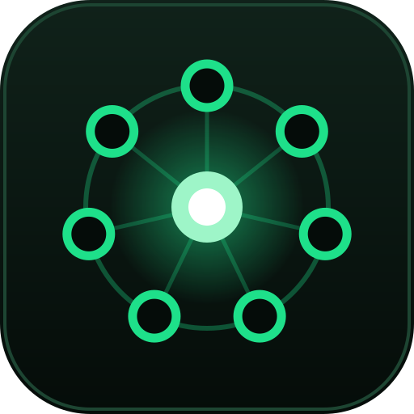

<p align="center">
  
</p>

<h1 align="center">Conclave-SDK</h1>

<p align="center">
  <strong>Agent kits for Claude Code, Codex and Antigravity.</strong><br>
  Skills, rules, independent review and a TODO system, copied into a project once and owned by it from then on.
</p>

<p align="center">
  
  
  
  
  
  
</p>

<p align="center">
  <a href="#quick-start">Quick start</a> ·
  <a href="#overlay-kits-kits">Kits</a> ·
  <a href="#commands">Commands</a> ·
  <a href="#todo-workflow-discipline">TODO workflow</a> ·
  <a href="#roadmap">Roadmap</a> ·
  <a href="CONTRIBUTING.md">Contributing</a>
</p>

Conclave-SDK is the central repository of overlay kits that carry agent skills, rules and subagent definitions (`base`, `todo`, `reviewer`, `automations`, `unattended`, `laravel`, `wordpress`), prompts, plugins, templates, and the canonical TODO graph tooling (`todo-graph.py`).

It is designed to be imported into any **new** or **existing** repository by **Google Antigravity / Gemini (`gemini` / `agy`)**, **Claude Code (`claude`)**, and **OpenAI Codex (`codex`)**:

- **Google Antigravity / Gemini (`gemini` / `agy`):** `.agents/skills/`, `.agents/rules/`, and `GEMINI.md`
- **Claude Code (`claude`):** `.claude/skills/`, `.claude/rules/`, `.claude/agents/`, and `CLAUDE.md`
- **OpenAI Codex (`codex`):** `.codex/skills/` (with `agents/openai.yaml`), `.codex/rules/`, and `CODEX.md`

Each agent reads only its own isolated folder and entrypoint alongside the shared project rules in `AGENTS.md`.

## Why it exists

- **One source for three agents.** A skill is written once per agent folder and installed the same way for Claude Code, Codex and Antigravity, so a project does not keep three setups by hand.
- **Copied once, owned by the project.** Nothing links a project back to the SDK. The project adapts its copy, `forge.py` never overwrites a file the project changed, and `diff` and `update` bring in later kit improvements safely.
- **Review by another model family.** The `reviewer` kit pins a reviewer that is never the writer's own model family, and the `todo` kit will not mark a section done without that review on record.
- **A plan that finishes.** The `todo` kit turns a plan into small sections with checkable steps, a generated plan file and a run guard that keeps an unattended run going.
- **Nothing to install.** Every script is Python 3 standard library only, with atomic writes, on Windows, Linux and WSL.

## Quick start

Clone the repository, then run `forge.py` from the clone against the project you want to set up.

```powershell
git clone https://github.com/rizonetech/Conclave-SDK.git
cd Conclave-SDK

# A new project: the base kit, plus the TODO system and independent review
python forge.py init ..\MyProject --kit todo --kit reviewer

# See what a project has and what its machine still needs
python forge.py check ..\MyProject
python forge.py doctor ..\MyProject
```

Then open the project in Claude Code, Codex or Antigravity. Each agent finds its own skills in its own folder.

## Overlay Kits (`kits/`)

| Kit | What it installs (for `.agents`, `.claude` and `.codex`) | Install when |
| --- | --- | --- |
| `base` | Entry docs, safety and authoring skills, subagents, rules | Every repository |
| `todo` | 8 TODO skills, `todo-graph.py`, starter `todo/` tree | Work planned in TODO files |
| `reviewer` | Reviewer pin, `review-dispatch.py`, review skill | Independent review |
| `automations` | `tasks.json`, runner, failure email, installers, skill | Scheduled checks |
| `unattended` | Skeleton so far; the launcher and the rest come in D02 T02 | Runs nobody watches |
| `laravel` | `boost.json`, `.mcp.json`, LSP diagnostics, `laravel-boost` | `artisan` exists |
| `wordpress` | Site pin, SSH/SFTP, WordPress MCP, DDEV, PHPCS | A WordPress site |

## Commands

| Command | What it does |
| ------- | ------------ |
| `python forge.py init <project> [--kit <kit>]` | Install the base kit plus the kits you name |
| `python forge.py kit <project> <kit>` | Add one kit to an existing project, copying only missing files |
| `python forge.py diff <project> [kit]` | Report each kit file's state against the kit, writing nothing |
| `python forge.py update <project> [kit]` | Write only the kit files the project lacks or never changed |
| `python forge.py record <project> [kit]` | Adopt an older install: record the files still identical to the kit |
| `python forge.py drift` | Report which projects in `.conclave/projects.json` drifted (exit 3 if any) |
| `python forge.py doctor <project> [kit]` | Read-only checks of a kit's files and the tools it needs |
| `python forge.py check <project>` | List the kits and skills a project has |
| `python forge.py kits` | List the kits this SDK ships |
| `python forge.py self-sync` | Refresh the SDK's own installed copy of its kits |

`kit` and `init` take `--agent all|gemini|agy|claude|codex`, and `kit` takes `--dry-run` to preview.

## Importing into a New or Existing Project (Gemini, Claude, or Codex)

Conclave-SDK is a template, not a master copy. `init` and `kit` copy files into the project once and never overwrite a file that is already there, and they note what they installed in the project's `.conclave/kits.json`: the SDK commit, and for each file its kit and a digest of its bytes as installed. The record holds no path back to the SDK and the project may delete it: nothing breaks, and forge then only knows less about which files are still as installed. From then on the project owns its copy: adapt the skills, scripts and pins to the project. To pick up a later SDK improvement, `diff` shows what changed and `update` takes only the files the project never edited; a file both sides changed is merged by hand with `update --kit-new` (see below).

Nothing is installed unless you ask for it: `init` always installs the `base` kit and adds only the kits you name. Run it from the clone, in Windows PowerShell or inside WSL.

### 1. New Project

```powershell
# Base only: AGENTS.md and the entry docs, safety and authoring skills, subagents, rules, verify-agent-tiers.mjs
python forge.py init ..\MyProject

# Add the TODO system (--with-todo is shorthand for --kit todo), or a stack kit
python forge.py init ..\MyProject --kit todo
python forge.py init ..\MyWordPressSite --kit wordpress --wp-host wpcom
python forge.py init ..\MyLaravelApp --kit todo --kit laravel
```

`init` plans every kit you name before it writes a file, so a kit that refuses (no `artisan` for `laravel`, an unknown name) leaves the folder as it was. `init --force` replaces the four entry docs (`AGENTS.md`, `GEMINI.md`, `CLAUDE.md`, `CODEX.md`, or only those for `--agent`) with the kit's, and first keeps each one it replaces as `<name>.replaced`; a doc that already holds what `init` would leave is not touched. To undo, copy the backup back (`Copy-Item AGENTS.md.replaced AGENTS.md`). `--force` refuses, before writing anything, to replace a doc whose `.replaced` holds an earlier version, since that is the only copy of it: move the old backup aside (`Rename-Item AGENTS.md.replaced AGENTS.md.replaced-1`) and run it again. A run cut short after backing a doc up can simply be run again.

### 2. Existing Project

`kit` adds one kit and only copies missing files: every file the project already has, its own or one an earlier copy left, is listed under `preserved` and left exactly as it is. It takes `--agent all|gemini|claude|codex` and `--dry-run` to preview. `check` lists the kits a repository appears to have, judged by their files alone.

```powershell
python forge.py kit ..\ExistingRepo base
python forge.py kit ..\ExistingRepo todo

# Read-only health and setup checks
python forge.py check ..\ExistingRepo
python forge.py doctor ..\ExistingRepo
```

A project installed before forge kept a record has no `.conclave/kits.json`, so `diff` cannot tell a file the kit has since changed from one the project edited. Adopt it first: `record` notes each file still exactly as the kit ships it (the only files whose installed bytes are known), leaves every entry already recorded alone, and lists the rest under `skipped` with the reason. Then see what changed, and take what is safe:

```powershell
python forge.py record ..\ExistingRepo --dry-run
python forge.py record ..\ExistingRepo
python forge.py diff ..\ExistingRepo
python forge.py update ..\ExistingRepo
```

### 3. Prompting Gemini, Claude, or Codex to Import Conclave-SDK

Paste the prompt from [`prompts/bootstrap-project-prompt.md`](prompts/bootstrap-project-prompt.md) into any Gemini, Claude, or Codex session open in your target repository.

### `diff`: what the SDK has that the project lacks

`python forge.py diff <project> [kit]` reads the project, the kits and `.conclave/kits.json`, and writes nothing. It prints JSON with each kit the project has (those the record names and those its files show), the agents compared for it, and a state for every kit file. `--patch` adds a unified diff, project side first, for each changed text file, or `binary`.

| State | What it means for the project |
| ----- | ----------------------------- |
| `missing` | The kit ships it and the project does not have it |
| `identical` | The project's bytes are the kit's (line endings aside) |
| `kit-newer` | Untouched since installed, and the kit has changed it since: safe to take |
| `project-changed` | The project edited it and the kit has not changed: the edit is the project's |
| `both-changed` | The project edited it and the kit changed it too: a hand merge |
| `project-removed` | Installed, then deleted by the project |
| `project-only` | Installed, and the kit no longer ships it |
| `differs` | No record entry (a kit installed before the record, or a file the project had first) |
| `unsafe` | A link, a folder, or under one: never read |
| `unreadable` | The read failed; `reason` says why |
| `generated` | Built by the kit (the Laravel `.mcp.json`), so there is no template to compare |

```powershell
python forge.py diff ..\ExistingRepo
python forge.py diff ..\ExistingRepo todo --patch
```

### `update`: take what is safe to take

`python forge.py update <project> [kit]` writes only the files `diff` calls `missing` or `kit-newer`, and never writes over a file the project changed: every other differing file is listed under `left` with its state and patch, for you to merge by hand. A file the project deleted (`project-removed`) comes back only when `--only` names it or its folder. Each file is recorded as it is written, so an update cut short is settled by the next `kit` or `update`. The generated Laravel `.mcp.json` is never copied (`kit` builds it). Without a record entry a differing file's installed bytes are unknown, so it is left.

```powershell
python forge.py update ..\ExistingRepo --dry-run
python forge.py update ..\ExistingRepo --only scripts/todo-graph.py --only .claude/skills/process-plan
python forge.py update ..\ExistingRepo --no-scripts
```

`--dry-run` lists what would be written and writes nothing. `--only` (repeatable) takes a file or folder relative to the project. `--no-scripts` leaves the kits' `scripts/` out, as `init --no-scripts` does.

A file both sides changed (`both-changed`, or `differs` with no record entry) is merged by hand. `--kit-new` writes the kit's version beside it as `<name>.kit-new`, never over it and never over a copy already there. Compare the two, edit the project's file, then record the merge: `record --merged` checks that the copy is still the kit's current version, records that version as the one installed and removes the copy. The file then reads `project-changed`, and a later kit change to it reads `both-changed` again.

```powershell
python forge.py update ..\ExistingRepo --kit-new
python forge.py record ..\ExistingRepo --merged .claude/skills/process-plan/SKILL.md
```

### `drift`: which projects need an update

`python forge.py drift` runs `diff` over every project in the SDK's `.conclave/projects.json` (the SDK keeps the list, because a project holds no path back to it) and prints one line per project: how many files can update, need a merge, are unrecorded (run `record`), missing, retired or incomplete, with up to 20 paths under each. It writes nothing and exits 3 when any project has one. The SDK's own scheduled task `conclave-sdk-drift` runs it every Monday at 07:30, and an exit of 3 sends the automations failure email, which is the report. Add a project by adding an entry with its `windows` and `posix` paths; see `.conclave/automations/README.md`.

## Isolation

`forge.py` copies tracked skills and rules into `.agents/`, `.claude/` and `.codex/` inside the target repository with zero external path dependencies: no link or stamp points at the SDK, and the install record names files and digests only. Every repository is 100% self-contained and each agent is isolated in its own directory.

The SDK itself is the one exception: it plans, reviews and schedules its own work with the `base`, `todo`, `reviewer` and `automations` kits, so it keeps an installed copy of them that `python forge.py self-sync` refreshes from the kits (`tests/test_forge.py` fails until the two match).

## TODO Workflow Discipline

The `todo` kit's eight skills (`add-todo`, `create-todo`, `groom-plan`, `process-phase`, `process-plan`, `process-todo-file`, `process-todo-section`, `review-todo-section`), its starter `todo/` tree and `docs/todo-workflow.md` enforce the canonical Conclave-SDK execution contract:

* **Small, single-responsibility sections:** Multi-subsystem, multi-dialog, or multi-workflow work is split into small, single-responsibility sections rather than coarse umbrella sections.
* **Readable table descriptions (`<= 88` chars):** Every section heading (`## N. <Title>`), `Deliverable` cell in `Implementation Order`, and `Scope` cell in index tables is a clear noun phrase of at most 88 characters (enforced by `todo-graph.py validate`) so raw Markdown table rows stay under 140 characters and do not wrap in raw `.md` editors.
* **Granular five-part micro-steps:** Every section carries 1 to 30 concrete micro-step items (typically 4 to 15 micro-steps, never a 1-bullet summary stub), ending with `- [ ] Commit: <message>`. Each non-Commit item names: (1) one action, (2) a concrete path/symbol/command in backticks, (3) `Done when:` observable end state in the same bullet, (4) `Cheaper substitute:` on UI and write items, and (5) a source citation when copying behavior.
* **100% complete development plan:** Running `process-plan` from start to finish leaves a 100% complete, shippable product with zero unowned SPEC controls, settings, refusal/error paths, undo/reverse paths, or persistence read-backs, and zero silent scope drops.
* **Logical step commits:** Commits follow logical steps within a section; review fix-loop commits append to the candidate range without amending.

## Roadmap

The SDK plans its own work with its own `todo` kit. The live plan is [`todo/implementation-plan.md`](todo/implementation-plan.md), generated from the TODO files, and the reasoning behind it is in [`docs/plans/2026-11-11-sdk-audit-and-roadmap.md`](docs/plans/2026-11-11-sdk-audit-and-roadmap.md).

| Phase | What it delivers |
| ----- | ---------------- |
| 0 | Three-pass review: a plan review, one round, a completion review (done) |
| 1 | An install record, `diff`, `update` and a weekly drift report |
| 2 | Unattended running: run guard for all three agents and an `unattended` kit |
| 3 | A todo graph that takes a project's own phases, Needs and caps |
| 4 | Antigravity and Codex as first-class writers |
| 5 | One command that runs every test, and generated skill copies |
| 6 | Tooling kits: language servers and build toolchains |
| 7 | The operating directive in the base kit |

## Running the SDK's own plan unattended

On Windows, `pwsh scripts/start-run.ps1` starts a Claude Code session in this checkout on the latest Opus, with permission prompts off and a `/goal` to finish the plan through the `process-plan` skill. `pwsh scripts/start-run.ps1 -InstallShortcut` puts "Conclave-SDK unattended run" on the desktop, and `-DryRun` prints what would run and changes nothing. When a run guard from an earlier session is held, it names that session and waits for Enter before the new session may take the run over; with no guard held, the new session is told never to take one over, so two launches cannot both write to the tree. The standing rules for such a run are in the Autonomy and ambition section of [`AGENTS.md`](AGENTS.md). The session signs in with the long-lived token in the user variable `CLAUDE_CODE_OAUTH_TOKEN` when one is stored, and with the claude.ai sign-in otherwise. The token is never printed.

## Repository Layout

| Path | Purpose |
| ---- | ------- |
| `forge.py` / `forge.cmd` | CLI: `init`, `kit`, `doctor`, `kits`, `check`, `self-sync`. |
| `kits/base/` | Every repo: entry docs, safety skills, subagents, rules, tier check. |
| `kits/todo/` | TODO skills, `todo-graph.py`, starter `todo/` tree, workflow doc. |
| `kits/reviewer/` | Reviewer pin (one reviewer of another model family) and dispatcher. |
| `kits/automations/` | Scheduled tasks for Task Scheduler and systemd, with a failure email. |
| `kits/unattended/` | Being built: a run kept going in tmux (D02 T02; not in the SDK itself). |
| `kits/laravel/`, `kits/wordpress/` | Stack kits. |
| `prompts/` | Copy-pasteable prompts to import Conclave-SDK from Gemini, Claude, or Codex. |
| `plugins/` | Account-bound Codex and Claude plugins that belong to no kit (never installed). |
| `global/` | The owner's machine-level Claude and Codex rules, hooks, skills (never installed). |
| `assets/brand/` | The icon, its PNG and ICO renders, and the social preview. |
| `tests/fixtures/check-pin/` | Pins and dispatchers freezing the `--check-pin` contract. |
| `todo/` | The SDK's own TODO plan. |
| `.agents/`, `.claude/`, `.codex/` | The SDK's own `base`, `todo`, `reviewer`, `automations`. |
| `scripts/`, `.conclave/` | The SDK's own todo, reviewer and automations scripts and pins. |
| `tests/` | Suites for `todo_graph.py`, `forge.py`, kits, `test_check_pin_contract.py`. |
| `.github/` | Issue and pull request templates. |

## Development

```powershell
python -m unittest discover -s tests                                     # the quick suite, about a minute
$env:CONCLAVE_FULL_TESTS = '1'; python -m unittest discover -s tests     # the full suite, several minutes
python scripts/todo-graph.py validate                                    # the SDK's own TODO tree
python forge.py self-sync                                                # after changing a kit file
```

Change a kit file in the kit, never in the SDK's installed copy. The working rules are in [`AGENTS.md`](AGENTS.md), and how to propose a change is in [`CONTRIBUTING.md`](CONTRIBUTING.md).

## Security

Report a vulnerability privately, as [`SECURITY.md`](SECURITY.md) describes. The repository holds no secret: credentials stay in a vault and are never printed, logged or committed.

## License

Copyright Rizonetech. All rights reserved. This repository is internal and carries no open-source license: no right to use, copy or distribute it is granted without written permission.
