# Conclave VS Code extension: interface SPEC

The interface the extension builds, written from the approved mockup (`design/mockup/project/Main.dc.html` at the current mockup source `design/decisions.md` names, canvas version 27) and `design/decisions.md`. Every control appears in exactly one section below, with its states, its keyboard path and the exact text it shows. Text in backticks is verbatim; `{name}` marks a value filled in at run time. Screenshots are from the published canvas, in Dark Modern and Light Modern. The mockup's control bar (theme, scenario, SDK source, workspace) is not part of the extension (`design/platform-audit.md`). The plan (`docs/plans/2026-10-16-vscode-extension.md`) owns the requirements; this file owns how they look and read.

## 1. Layout and theming

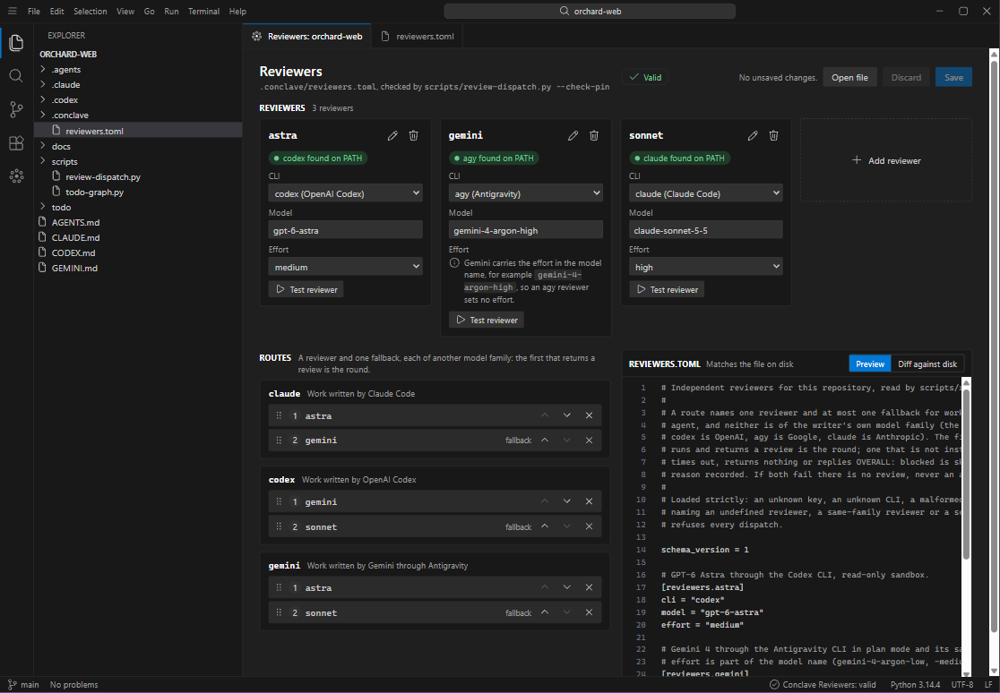
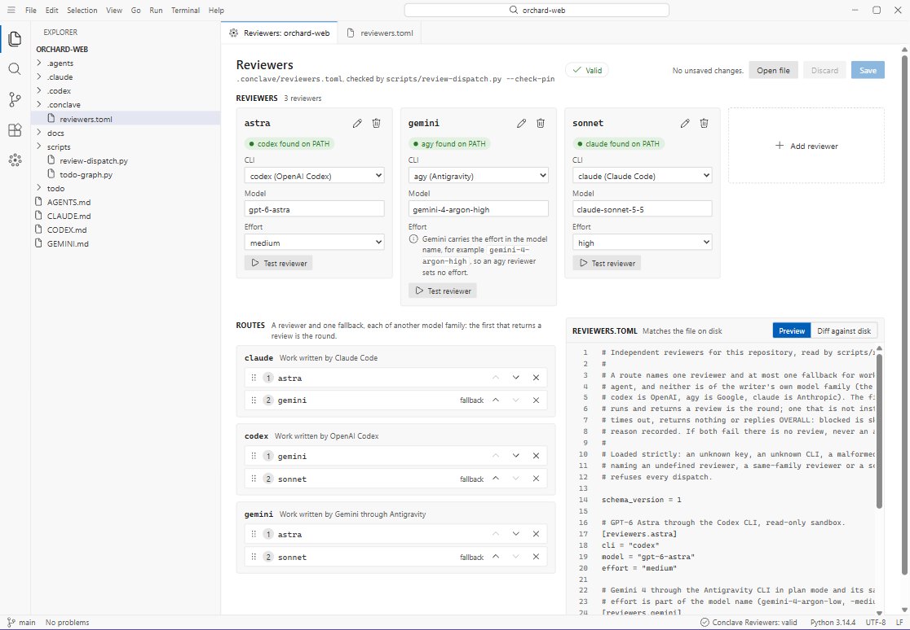

The Reviewers editor is a webview panel (`design/decisions.md` answer 4) titled `Reviewers: {folder}`, with ` (unsaved)` appended while it has unsaved edits (a webview tab has no dirty dot). Top to bottom it holds:

- The header: `h1` `Reviewers` (20px, weight 600), under it the path line `.conclave/reviewers.toml, checked by scripts/review-dispatch.py --check-pin`; at the right the status pill (§4), the Save reason text, and the buttons `Open file`, `Discard` and `Save`, gap 8px. The header has a 16px gap and a 14px bottom margin.
- Banners (§4), full width, when one applies.
- The `REVIEWERS` section (§2): a four-column card grid with a 12px gap and an 18px bottom margin.
- Two equal columns with a 16px gap: `ROUTES` (§3) on the left and the TOML panel (§6) on the right.

The webview body has padding `18px 24px 28px`. Section headings are 11px, weight 700, upper case, letter spacing .06em, followed by a muted caption or count. Cards have padding `10px 12px 12px`, a gap of 8px and a 4px radius; route boxes padding `10px 12px` and a 10px bottom margin; chips are 30px high with a gap of 6px. Buttons are 28px high (padding `0 12px`, radius 2px); `small` buttons 24px (padding `0 8px`, 12px text); icon buttons 26 by 26; inputs and selects 26px high. Disabled controls are at 45 percent opacity (icon buttons 35 percent). The focus ring is `1px solid` the focus colour with a 1px offset. A toast sits bottom right (32px from the bottom, 20px from the right, at most 460px wide), `role="status"`, with a clear button labelled `Clear notification` (title `Clear Notification`).

Fonts: the UI uses VS Code's `--vscode-font-family` (the mockup draws `"Segoe WPC","Segoe UI",system-ui,sans-serif`) at 13px; names, models, code and the TOML use `--vscode-editor-font-family` (mockup `"Cascadia Code",Consolas,"Courier New",monospace`). Sizes: 20 (title), 14 (card name), 13 (body, chip name), 12 (labels, notes, code, small buttons), 11 (section headings, chip tag, line numbers).

Colours come only from the theme (alpha colours are written as 8-digit hex: `#9bb95538` is `rgba(155,185,85,.22)`). Each mockup token and the VS Code theme variable the build uses for it (Dark Modern and Light Modern values as the mockup draws them):

| Token | Dark | Light | VS Code variable |
| --- | --- | --- | --- |
| `--bg-editor` | `#1f1f1f` | `#ffffff` | `--vscode-editor-background` |
| `--bg-side` | `#181818` | `#f8f8f8` | `--vscode-sideBar-background` |
| `--bg-title` | `#181818` | `#f8f8f8` | `--vscode-titleBar-activeBackground` |
| `--bg-status` | `#181818` | `#f8f8f8` | `--vscode-statusBar-background` |
| `--border` | `#2b2b2b` | `#e5e5e5` | `--vscode-panel-border` |
| `--fg` | `#cccccc` | `#3b3b3b` | `--vscode-foreground` |
| `--fg-muted` | `#9d9d9d` | `#616161` | `--vscode-descriptionForeground` |
| `--fg-strong` | `#ffffff` | `#1f1f1f` | `--vscode-editor-foreground` |
| `--input-bg` | `#313131` | `#ffffff` | `--vscode-input-background` |
| `--input-border` | `#3c3c3c` | `#cecece` | `--vscode-input-border` |
| `--focus` | `#0078d4` | `#005fb8` | `--vscode-focusBorder` |
| `--btn-bg` | `#0078d4` | `#005fb8` | `--vscode-button-background` |
| `--btn-fg` | `#ffffff` | `#ffffff` | `--vscode-button-foreground` |
| `--btn-hover` | `#026ec1` | `#0258a8` | `--vscode-button-hoverBackground` |
| `--btn2-bg` | `#313131` | `#e5e5e5` | `--vscode-button-secondaryBackground` |
| `--btn2-fg` | `#cccccc` | `#3b3b3b` | `--vscode-button-secondaryForeground` |
| `--btn2-hover` | `#3c3c3c` | `#cccccc` | `--vscode-button-secondaryHoverBackground` |
| `--card-bg` | `#181818` | `#f8f8f8` | `--vscode-sideBar-background` |
| `--card-border` | `#2b2b2b` | `#e5e5e5` | `--vscode-panel-border` |
| `--err` | `#f85149` | `#a1260d` | `--vscode-errorForeground` |
| `--err-bg` | `#5a1d1d` | `#fbeceb` | `--vscode-inputValidation-errorBackground` |
| `--err-border` | `#be1100` | `#be1100` | `--vscode-inputValidation-errorBorder` |
| `--warn` | `#cca700` | `#7a5600` | `--vscode-editorWarning-foreground` |
| `--warn-bg` | `#352a05` | `#fdf4dd` | `--vscode-inputValidation-warningBackground` |
| `--warn-border` | `#b89500` | `#bf8803` | `--vscode-inputValidation-warningBorder` |
| `--info-bg` | `#1b2a3a` | `#eaf2fb` | `--vscode-inputValidation-infoBackground` |
| `--info-border` | `#0078d4` | `#005fb8` | `--vscode-inputValidation-infoBorder` |
| `--ok` | `#73c991` | `#2d7a2a` | `--vscode-testing-iconPassed` |
| `--badge-ok-bg` | `#1e3a29` | `#e3f1e2` | `--vscode-conclave-badgeOkBackground` |
| `--badge-off-bg` | `#3a1e1e` | `#fbeceb` | `--vscode-conclave-badgeErrorBackground` |
| `--code-bg` | `#181818` | `#f8f8f8` | `--vscode-textCodeBlock-background` |
| `--diff-add` | `#9bb95538` | `#9bb95547` | `--vscode-diffEditor-insertedLineBackground` |
| `--diff-del` | `#ff000038` | `#ff000024` | `--vscode-diffEditor-removedLineBackground` |
| `--tab-active` | `#1f1f1f` | `#ffffff` | `--vscode-tab-activeBackground` |
| `--tab-inactive` | `#181818` | `#f8f8f8` | `--vscode-tab-inactiveBackground` |
| `--tab-top` | `#0078d4` | `#005fb8` | `--vscode-tab-activeBorderTop` |
| `--list-active` | `#37373d` | `#e4e6f1` | `--vscode-list-inactiveSelectionBackground` |
| `--chip-bg` | `#2b2b2b` | `#ffffff` | `--vscode-input-background` |
| `--act-on` | `#d7d7d7` | `#1f1f1f` | `--vscode-activityBar-foreground` |
| `--act-off` | `#868686` | `#616161` | `--vscode-activityBar-inactiveForeground` |
| `--line-no` | `#6e7681` | `#6e7681` | `--vscode-editorLineNumber-foreground` |
| `--drop` | `#0078d4` | `#005fb8` | `--vscode-list-dropBackground` |
| `--shadow` | `rgba(0,0,0,.36)` | `rgba(0,0,0,.16)` | `--vscode-widget-shadow` |
| `--badge-bg` | `#0078d4` | `#005fb8` | `--vscode-activityBarBadge-background` |
| `--badge-fg` | `#ffffff` | `#ffffff` | `--vscode-activityBarBadge-foreground` |
| `--hover` | `#2a2d2e` | `#f2f2f2` | `--vscode-list-hoverBackground` |
| `--qi-bg` | `#222222` | `#f8f8f8` | `--vscode-quickInput-background` |
| `--qi-border` | `#313131` | `#e5e5e5` | `--vscode-widget-border` |
| `--qi-active` | `#04395e` | `#e8e8e8` | `--vscode-quickInputList-focusBackground` |
| `--qi-active-fg` | `#ffffff` | `#1f1f1f` | `--vscode-quickInputList-focusForeground` |
| `--menu-bg` | `#1f1f1f` | `#ffffff` | `--vscode-menu-background` |
| `--menu-border` | `#454545` | `#cecece` | `--vscode-menu-border` |
| `--menu-sel` | `#0078d4` | `#005fb8` | `--vscode-menu-selectionBackground` |
| `--menu-sel-fg` | `#ffffff` | `#ffffff` | `--vscode-menu-selectionForeground` |
| `--dlg-bg` | `#202020` | `#f8f8f8` | `--vscode-editorWidget-background` |
| `--scrim` | `rgba(0,0,0,.3)` | `rgba(0,0,0,.15)` | none: VS Code draws its own modal scrim |

The two badge backgrounds have no theme variable of VS Code's, so the extension contributes two colours (`contributes.colors`: `conclave.badgeOkBackground` and `conclave.badgeErrorBackground`) whose `dark` and `light` defaults are the values in the table (the high-contrast defaults take the dark and light values), and the webview reads them as `--vscode-conclave-badgeOkBackground` and `--vscode-conclave-badgeErrorBackground`; a theme or `workbench.colorCustomizations` can override them (`design/decisions.md`, 2026-10-20). The quick input, menu, dialog, activity bar, tab and status bar tokens describe VS Code's own chrome, which the mockup draws and the extension does not: the build uses them only where a webview mirrors that chrome. Links use `--vscode-textLink-foreground` and `--vscode-textLink-activeForeground`.

## 2. Reviewer cards

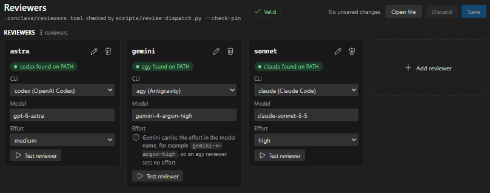
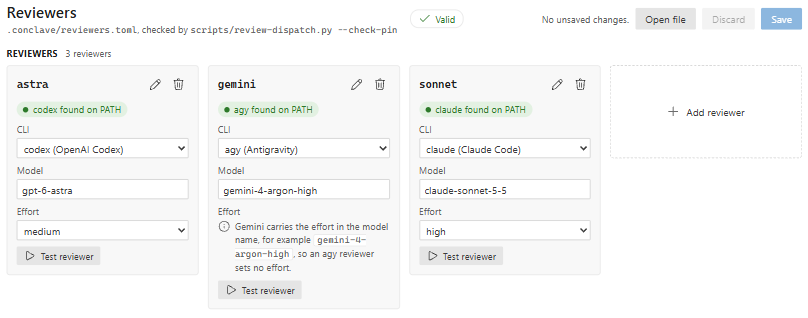

One card per reviewer (plan R1 to R3), an `article` labelled `Reviewer {name}`; a card with an error has the error border. Card parts, top to bottom:

- Header: the name (monospace, 14px), a pencil button (`Rename {name}`, title `Rename`) and a bin button (`Delete {name}`, title `Delete`).
- CLI status badge (§5).
- `CLI`: a select with `codex (OpenAI Codex)`, `agy (Antigravity)`, `claude (Claude Code)`; a value the editor does not know is shown first as `(unknown: {cli})`. Changing to agy clears the effort; changing to codex or claude keeps the effort when allowed, else sets the default (codex `medium`, claude `high`).
- `Model`: a text input, monospace, committed on change.
- `Effort`: a select of `low`, `medium`, `high`, `xhigh` for codex, and `low`, `medium`, `high`, `xhigh`, `max` for claude; a missing value shows `(not set)` and a disallowed one `(not allowed: {x})` until changed. Choosing either of those is ignored.
- For an agy reviewer, `Effort` shows a note instead of the select: `Gemini carries the effort in the model name, for example` `gemini-4-argon-high` `, so an agy reviewer sets no effort.` A stray `effort = "{value}"` on an agy reviewer shows as a row with a `Remove` button.
- Keys the dispatcher does not know show under the label `Keys the dispatcher does not know`, one `{key} = {value}` row each with `Remove`.
- `Test reviewer` (§5).

Rename: the pencil swaps the name for an input (label `New name for {name}`) with `Rename` and `Cancel`, and the note `Renaming also rewrites every route entry that names it. Enter to rename, Escape to cancel.` Enter renames, Escape cancels. An empty or unchanged name closes the input; a taken one shows `A reviewer named '{draft}' already exists. Names are table keys, so each must be unique.` A name the dispatcher refuses is reported by §4.

Delete: the bin shows an alert in the card, `Delete {name}?`, with the impact and `Delete` and `Cancel`. The impact is `It is removed from the {writers} route.` (or `routes.`), or `No route names it.`; and, when a route would be left empty, `{writers} is then left with no reviewer, so that work gets no review.` (`are then left` for more than one). A route left empty is removed. Starting a delete closes a rename, and the other way round.

Add reviewer: a dashed card with a plus and `Add reviewer` opens a form, `New reviewer`, with `Name`, `CLI`, `Model` and `Effort` (default claude, `high`), the agy note `No effort: Gemini carries it in the model name.`, and `Add` and `Cancel`. Errors: `Give the reviewer a name.` and `A reviewer named '{name}' already exists.`

Keyboard: every control is a native button, input or select in tab order; Enter and Escape act in the rename input.

## 3. Route rows

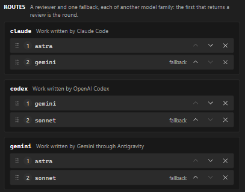
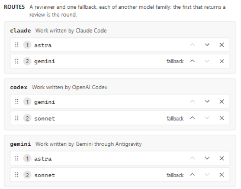

Heading `ROUTES`, caption `A reviewer and one fallback, each of another model family: the first that returns a review is the round.` (plan R4 to R6, `design/decisions.md` Reviewer routes, 2026-10-20). One row each for `claude`, `codex` and `gemini`, captioned `Work written by Claude Code`, `Work written by OpenAI Codex` and `Work written by Gemini through Antigravity`. A key in `[routes]` that names no writer gets its own row, captioned `Not a writer: [routes] may only name claude, codex and gemini`, with a `Remove route` button.

Chips: an ordered list labelled `Reviewer and fallback for {writer}`. The editor adds at most two; a route edited by hand with more shows every entry it has (with the route's refusal, §4), so the extra one can be removed. Each chip has a drag grip, its number (`1`, `2`), the reviewer's name (monospace) and, on the second, the tag `fallback`. A name no reviewer has shows the tag `not defined`, and a name listed twice `listed twice`; both chips get a dashed error border. Buttons on each chip: `Move {name} up` (off on the first chip), `Move {name} down` (off on the last) and `Remove {name} from the {writer} route`. Dragging reorders within the row. Removing the last chip removes the writer's key from `[routes]`, never writing `[]`.

Add menu: a select labelled `Add a reviewer to the {writer} route`, shown while the row has fewer than two chips and reviewers exist. Its first option reads `Add a reviewer to create the route` (no key), `Add the reviewer` (an empty list) or `Add the fallback` (one chip). Every reviewer follows; one the pin would refuse is disabled with its reason, the first that applies of `{name} (already in this route)`, `{name} (same family as the writer)` and, for the fallback, `{name} (same family as the reviewer)`. The family is the CLI's: codex is OpenAI, agy Google, claude Anthropic; the writers are claude (Anthropic), codex (OpenAI) and gemini (Google).

Notices:

- No route (the writer has no key): `No route.` `Work written by {writer} gets no review:` `review-dispatch.py` `refuses` `--writer {writer}` `. Add a reviewer to create the route.`
- Empty list (`{writer} = []` in the file): `The file sets` `{writer} = []` `. Add a reviewer, or remove the route so this writer gets no review on purpose.` with `Remove route`.
- A route the dispatcher refuses (a hand-edited pin, or a reviewer's CLI changed into the writer's family or its fallback's): the row gets the error border and the refusal under the chips, verbatim (§4). Save is off.

Keyboard: the chips' buttons and the native select; drag has the move buttons as its keyboard path.

## 4. Validation and Save

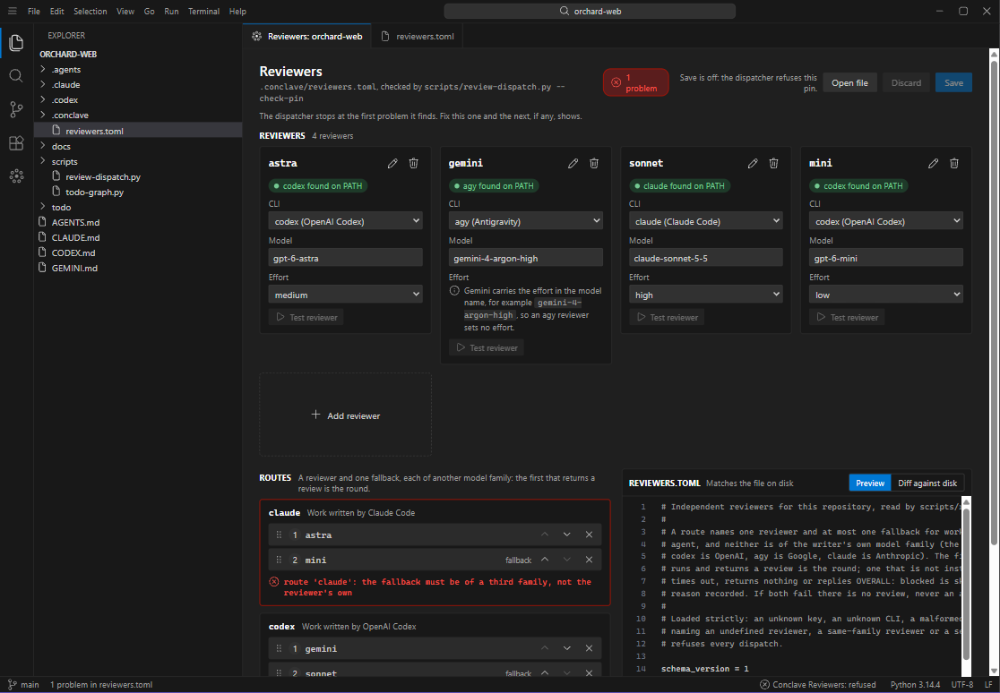
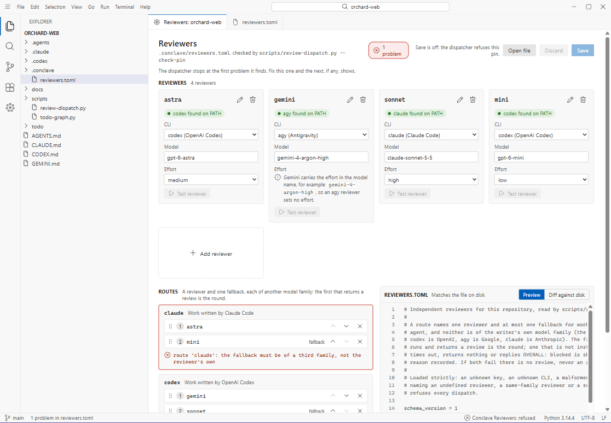

The editor never validates the pin itself (plan R7): every check is `scripts/review-dispatch.py --check-pin --json` run on the candidate text, and one error shows at a time (`design/decisions.md` answer 2).

Header status pill: `Valid` (pass icon), `Valid, not saved` (after an edit), or `1 problem` (error icon, error colours). With a problem, the line `The dispatcher stops at the first problem it finds. Fix this one and the next, if any, shows.` sits under the title.

Save reason, at the left of the buttons and as Save's title, the first that applies: `Save is off: the dispatcher refuses this pin.`, `Save is off: the file changed on disk.`, `Save is off until you reload.`, `No unsaved changes.`, or nothing when Save is on.

Buttons: `Open file` (always on; opens `.conclave/reviewers.toml` in the text editor), `Discard` (off without changes), `Save` (off with a problem, a stale file, kept edits or no changes). Save writes through a temporary file and a rename, re-checks, and shows the toast `Saved .conclave/reviewers.toml through a temporary file and a rename. Re-checked with --check-pin: ok.`; if the re-check refuses the saved pin, the toast is `Saved, but --check-pin now refuses the pin: {message}` and the refusal shows at its field (`docs/specs/2026-10-20-vscode-extension-design.md` section 4) Discard asks first in a warning banner: `Discard your unsaved edits and go back to the file on disk?` with `Discard edits` and `Keep editing`.

File changed on disk while open: an alert banner, `.conclave/reviewers.toml` `changed on disk after this editor loaded it.`, with `Reload from disk` (toast `Reloaded from disk. Re-checked with --check-pin: ok.`) and `Keep my edits`, which leaves the info banner `Keeping your edits. Save stays off until you reload, so the change on disk is never overwritten.` and `Reload from disk`.

Where each refusal attaches (the message verbatim, in the editor font, under the field it names):

- `invalid reviewer '{name}'`: the card's name.
- `reviewer '{name}' has unknown keys: {keys}`: the card's unknown-keys rows.
- `reviewer '{name}' needs cli = one of codex, agy, claude`: the card's CLI.
- `reviewer '{name}' has a malformed model`: the card's model.
- `reviewer '{name}': Antigravity carries the effort in the model name, so set no effort`: the card's stray effort row.
- `reviewer '{name}' needs effort = one of {efforts}`: the card's effort.
- `the reviewer pin defines no reviewers`: above the cards.
- `[routes] may only name the writers claude, codex, gemini`: the unknown writer's row.
- `route '{writer}' must list one reviewer and at most one fallback`: the writer's row (an empty list or a second fallback).
- `route '{writer}' must list defined reviewers, each once`: the writer's row.
- `route '{writer}' names {names}, of the writer's own family; a review comes from a different family`: the writer's row.
- `route '{writer}': the fallback must be of a third family, not the reviewer's own`: the writer's row.
- `the reviewer pin needs exactly schema_version = 1, [reviewers.*] and [routes]` and `unreadable reviewer pin: ...`: the pin-refused screen (§7), since the editor opens only a pin whose TOML parses with that shape (`design/decisions.md` answer 3).

The mockup's status bar problems item (`1 problem in reviewers.toml`, `No problems`) is VS Code's own chrome (`design/platform-audit.md`); the extension does not draw it.

## 5. Status and Test reviewer

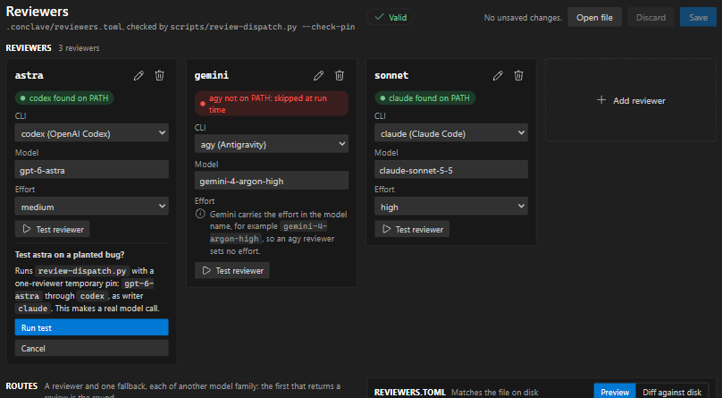
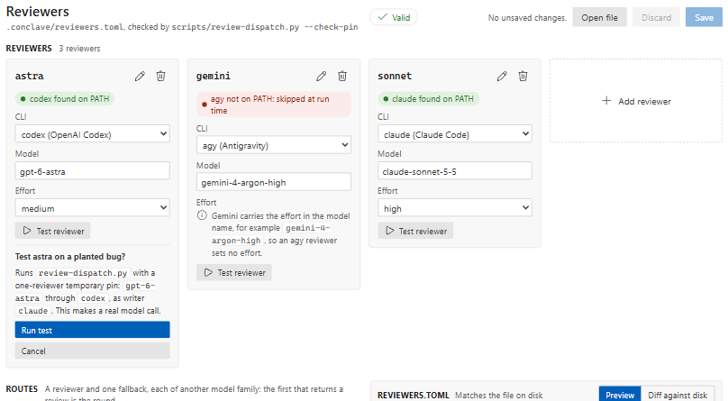

CLI status (plan R10), a badge with a dot on each card, from the `clis` map of the latest `--check-pin`: `{cli} found on PATH` (ok colours), `{cli} not on PATH: skipped at run time` (error colours), or `unknown CLI`.

Test reviewer (plan R11, `design/decisions.md` answer 6), a small secondary button with a play icon. Its title is `Run one review of a planted bug through this reviewer alone`; it is off, with the title saying why, when the pin has a problem (`Fix the problem first: the dispatcher refuses this pin`), another test runs (`Another test is running`) or the CLI is unknown (`Unknown CLI`). A refused pin therefore never reaches a run.

1. Confirmation, inside the card: `Test {name} on a planted bug?` and `Runs` `review-dispatch.py` `with a one-reviewer temporary pin:` `{model}` `through` `{cli}` `, as writer` `{writer}` `. This makes a real model call.` with `Run test` and `Cancel`. The writer is `codex` for a claude reviewer and `claude` otherwise, so the reviewer is never of the writer's family.
2. Running: a spinner, `Waiting for {name} ({model})`, and `Cancel`, which stops the dispatcher.
3. A review: the heading `Review returned` (ok colour) and the reviewer's own text verbatim in a preformatted block, then `Close`.
4. No review: the heading `No review` (error colour), the dispatcher's failover lines verbatim (for example `Skipped: {name} ({cli} is not installed)`) and `No reviewer returned a review. A round with no reviewer is never an approval.`, then `Close`. A timeout or a reply ending `OVERALL: blocked` is a failover reason like any other.

The results area is `aria-live="polite"`.

## 6. TOML preview and diff

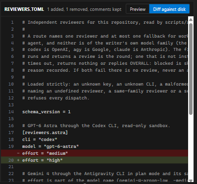
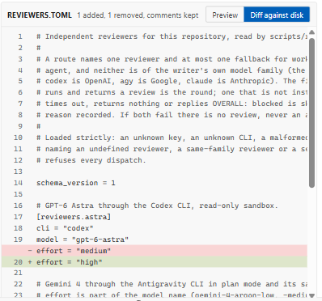

A panel labelled `TOML preview` (plan R12): the heading `reviewers.toml`, a muted caption, and a segmented control labelled `Preview or diff` with `Preview` and `Diff against disk` (the active one pressed, in button colours).

Captions: Preview shows `Matches the file on disk` or `What Save writes (unsaved)`; Diff shows `No changes` or `{n} added, {m} removed, comments kept`.

The code region is labelled `File text`: the editor font at 12px on 18px lines, at most 440px high and scrolling. Each line has a 34px right-aligned gutter (line number colour, not selectable), a 14px marker column and the text. Preview numbers every line. Diff is a line diff of the file on disk against the candidate: an added line is marked `+` on the inserted-line background and numbered in the new file; a removed line is marked `-` on the removed-line background and has no number; an unchanged line has no marker and no background, and is numbered in the new file. A comment line (text starting with `#`) is in the muted colour in every case. Comments always survive an edit (plan R12; `D00 T01 §4` settles how).

## 7. Empty and failure states

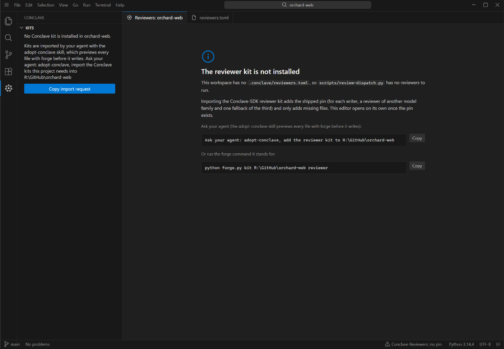
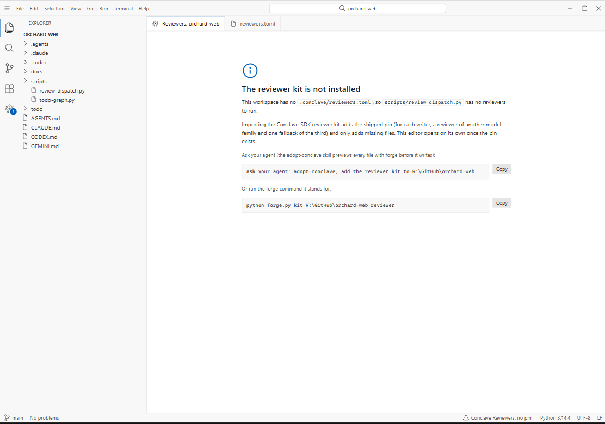

When the editor cannot show a pin it shows one state in place of it: an icon (info, warning or error), a title, its paragraphs, an optional command or output block, and the actions (primary first). `Retry` re-checks and, when nothing changed, says `Re-checked with --check-pin: the state has not changed.`; `Copy command` says `Copied the command to the clipboard.`

- No pin (info): `No reviewer pin in this workspace`. `This workspace has no` `.conclave/reviewers.toml` `, so` `scripts/review-dispatch.py` `has no reviewers to run.` `Install the Conclave-SDK reviewer kit to add the shipped pin (for each writer, a reviewer of another model family and one fallback of the third). The installer opens in the Conclave side bar, preset to the reviewer kit, and lists every file it would add before it writes anything. It only adds missing files.` Then `The installer runs forge.py from the SDK source after its preview:` and `python forge.py kit {folder} reviewer --agent all`. Actions `Install reviewer kit` (opens §10's installer), `Copy command`, `Retry`. After the install: `Reviewer pin added. Re-checked with --check-pin: ok.`
- No dispatcher (warning): `No dispatcher in this workspace`. `scripts/review-dispatch.py is missing. Conclave Reviewers never checks the pin itself: every rule comes from the workspace dispatcher, so without it there is nothing to check the pin against.` `Sync the reviewer kit scripts from Conclave-SDK. Your pin is not touched.` `Command:` `python forge.py sync {folder} --include-scripts`. Actions `Update from Conclave-SDK`, `Copy command`, `Open the pin as text`, `Retry`.
- Dispatcher too old (warning): `This dispatcher is too old for the editor`. `scripts/review-dispatch.py does not support --check-pin. Asked to check the pin, it printed no JSON:`, the output under `python scripts/review-dispatch.py --check-pin --json (exit 2)`, `Update it from Conclave-SDK. Your pin is not touched.`, the command. Actions `Update from Conclave-SDK`, `Copy command`, `Retry`.
- Update from Conclave-SDK (from either dispatcher state): a confirmation `Update from Conclave-SDK?` with `forge.py sync refreshes every kit this folder has from {source}: skills, rules, subagents, scripts/ and bin/, and adds any kit file that is missing, scripts/review-dispatch.py among them.`, the scope sentence `It never changes an existing AGENTS.md, GEMINI.md, CLAUDE.md, CODEX.md, docs/, todo/ or .conclave/reviewers.toml, and Conclave checks that by hash afterwards.`, `Runs:` and the command, and `Update` and `Cancel`. A refused SDK source shows `Nothing was updated`, `The SDK source refused:` and the source's refusal with its actions (§8). The result: `Updated from Conclave-SDK`, `{argv}: {n} files added, {m} files updated.` (or `Nothing to do: every kit file matches the SDK.`), one row per file with `{kit}: added` or `{kit}: updated`, the hash line (§10), `Re-checked with --check-pin: ok.` and `Open the editor`.
- No Python (error): `No Python 3.11 or later`. `The dispatcher needs Python 3.11 or later: it reads the pin with tomllib. Nothing was run. Tried, in order:` then each try and its result (`conclave.pythonPath`, `py -3`, `python` on Windows; `python3`, `python` in WSL), then `Install Python 3.11 or later, or point the setting at one. In a Remote WSL window the editor runs on the Linux side and tries python3, then python.` Actions `Open Settings` (at `conclave.pythonPath`), `Retry`.
- Untrusted workspace (warning): `Restricted Mode`. `This editor runs scripts/review-dispatch.py from the workspace, so it works only in a trusted workspace. Nothing has been run.` Action `Manage Workspace Trust`.
- Layout not editable (warning): `This pin uses a layout the editor does not edit`. `The pin is valid, and reviews run. It is written with inline tables, quoted keys or arrays over several lines, and the editor edits only [reviewers.<name>] tables with one key per line and a one-line array per route, so it changes nothing here: every comment and line stays as you wrote it.` `Edit the file by hand, or rewrite it in that layout to edit it here.` Actions `Open file`, `Retry`. The layout is the one `docs/specs/2026-10-20-vscode-extension-design.md` section 2 defines; the pin is valid by `--check-pin` first.
- Newer schema (warning): `This pin is newer than the editor`. `The workspace dispatcher accepts schema_version = {n}, but this version of Conclave Reviewers edits schema_version = 1 only. Reviews still run.` `Update the extension, or edit the file by hand.` Actions `Open file`, `Retry`.
- Pin refused (error): `The reviewer pin was refused`. `scripts/review-dispatch.py --check-pin says:` and the refusal in an error box; `Every review round is refused until this is fixed. The editor opens a pin only when its TOML parses and it has exactly schema_version, [reviewers.*] and [routes], so fix this one in the file.`; a six-line excerpt (two lines before the faulty one, marked `>` on the error background, two after). Actions `Open file at line {n}`, `Retry`.

## 8. Entry points and SDK source

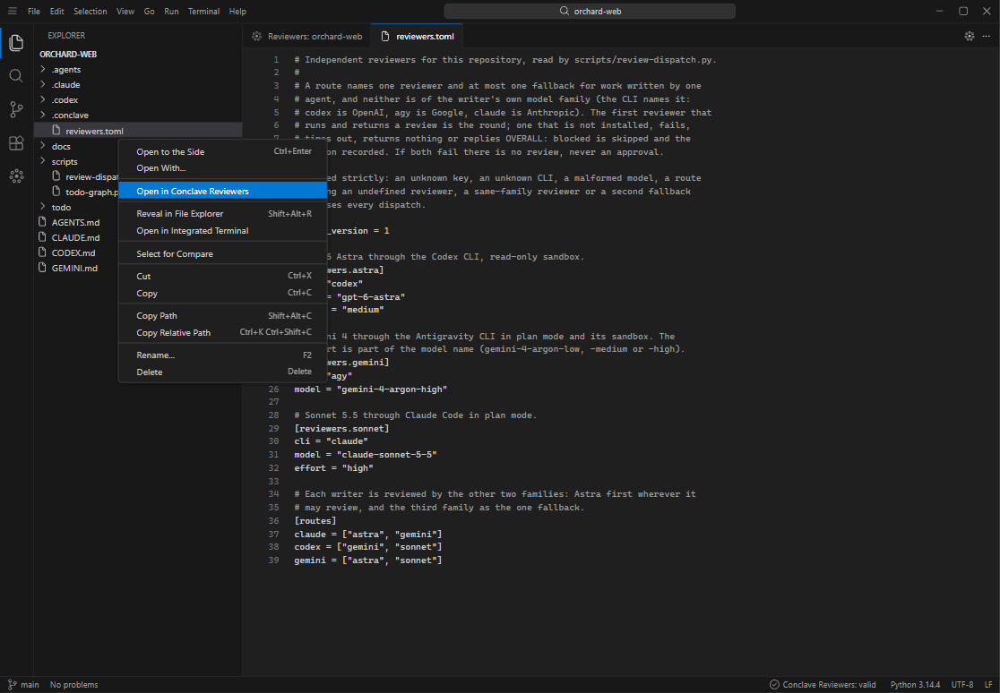
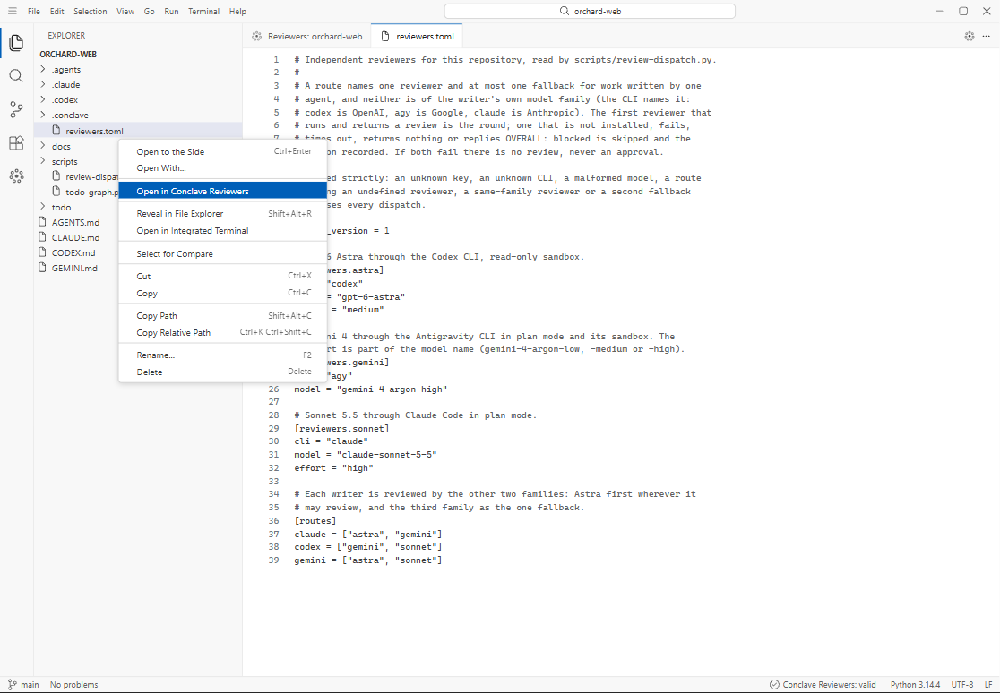

Entry points (plan R26, `design/decisions.md` answer 10):

- Command Palette: `Conclave: Open Reviewer Settings` (`conclave.openReviewers`), `Conclave: Update Kits`, `Conclave: Set Up a New Repository`, `Conclave: Refresh Kits`, and in a multi-root workspace `Conclave: Switch Folder`.
- Explorer context menu on `.conclave/reviewers.toml` only: `Open in Conclave Reviewers`.
- Editor title button, while the pin is open as text: `Open in Conclave Reviewers` (title and label).
- Status bar item: `Conclave Reviewers: {state}` with `valid` (pass icon) or `refused` (error icon) in the editor, and otherwise `pin refused`, `no dispatcher` or `no Python` (error icon), or `layout not editable`, `newer schema`, `no pin`, `dispatcher too old` or `Restricted Mode` (warning icon). Its tooltip is `Conclave Reviewers: ` and one of `the dispatcher refuses this pin`, `the pin is valid` or the state, then `. Open Reviewer Settings`; clicking it opens the editor. A Python item beside it reads `Python {version}` or `Python: none usable`.

SDK source (plan R24, R25, `design/decisions.md` answers 8 and 9): every forge run names its source as `bundled Conclave-SDK@{sha}` (the default), the `conclave.sdkPath` checkout path, or `rizonetech/Conclave-SDK@{sha}` (`conclave.sdkRef`, resolved to a commit). A source that fails is shown, wherever forge would have run, as its title and body, `Nothing was downloaded or run.`, and its actions, primary first:

- `GitHub sign-in was cancelled.` `conclave.sdkRef is set, so forge.py comes from rizonetech/Conclave-SDK, which needs a GitHub account in the rizonetech organization (repo scope).` Actions `Sign in to GitHub`, `Use the bundled SDK`.
- `GitHub returned 404 for rizonetech/Conclave-SDK.` `The signed-in GitHub account cannot read it. The repository is internal to the rizonetech organization: ask an organization owner for access, or sign in with a member account.` Actions `Sign in with another account`, `Use the bundled SDK`.
- `The GitHub API rate limit is used up until {time}.` `Resolving conclave.sdkRef ({ref}) to a commit calls the GitHub API.` Actions `Retry`, `Use the bundled SDK`.
- `Could not reach api.github.com.` `Resolving conclave.sdkRef ({ref}) to a commit needs the network. Commits downloaded earlier stay cached, but a branch name is resolved online every time.` Actions `Retry`, `Use the bundled SDK`.
- `conclave.sdkPath is not a Conclave-SDK checkout.` `{path} has no forge.py. The setting must point at a folder that holds forge.py and kits/.` Actions `Open Settings`, `Use the bundled SDK`.

`Use the bundled SDK` removes the workspace setting and says `Removed conclave.sdkRef from this workspace: forge.py now comes from the bundled SDK.` (or `conclave.sdkPath`).

## 9. Kits view and health

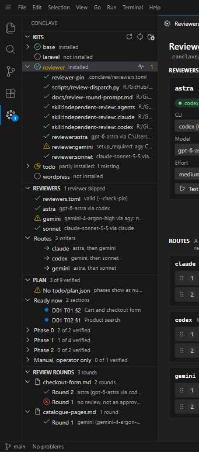
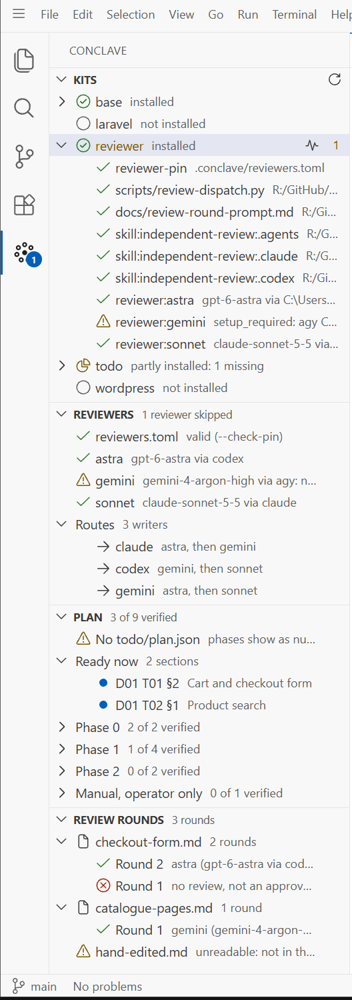

A `Conclave` view container in the Activity Bar (the Council mark, `extensions/vscode/media/conclave.svg`), with a badge counting the current folder's kits that have at least one doctor check not ok (none at zero; a kit that is not installed has no checks). Its title is `Conclave`, or `Conclave ({n} kit needs attention)` (`kits need` for more than one). The side bar heading is `CONCLAVE` (plan R27, R30, `design/decisions.md` answers 11 and 14).

The `KITS` tree lists every kit `forge.py kits` returns for the current folder, in that order. In a multi-root workspace its description is the folder's name (tooltip the full path). View title actions, on hover: `Switch folder` (multi-root only; title `Switch folder (the view follows the active editor's folder)`, codicon `arrow-swap`), `Refresh` (`refresh`), `Update kits` (`sync`) and `Set up a new repository` (`new-folder`).

Kit nodes, with their state from forge's `kit --dry-run`:

- Installed: codicon `pass`, description `installed`, inline action `Health`.
- Partly installed: codicon `chart-pie`, description `partly installed: {n} missing`, inline actions `Install` and `Health`.
- Not installed: codicon `circle-large-outline`, description `not installed`, inline action `Install`, no children.

`Install` is labelled `Install {kit} in {folder}` (codicon `desktop-download`) and `Health` `Health of {kit} in {folder}` (codicon `pulse`), which expands the node. A kit with checks not ok carries a `FileDecoration` badge with their count (two characters at most) and the tooltip `{n} doctor check needs attention` (`checks need` for more than one); the label is tinted. Expanded, a kit shows one row per `forge.py doctor` check: the check's name, and as description its detail when ok, else `{status}: {detail}` (tooltip always `{status}: {detail}`). Icons: `check` for ok (`testing.iconPassed`), `error` for missing or any unknown status (`list.errorForeground`), `warning` for setup_required (`list.warningForeground`). `Refresh` says `Refreshed: forge.py kits, then kit --dry-run and doctor for {folder}.`

## 10. Kit install and update

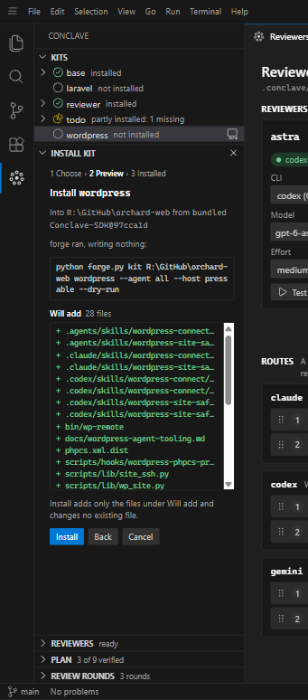
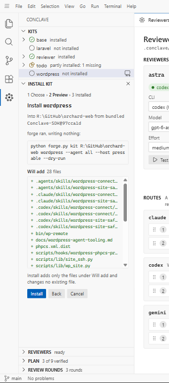

Install (plan R28) opens an `INSTALL KIT` view under the Kits tree, which shrinks to half height, with `Close` (label `Close the installer`). A step strip reads `1 Choose`, `2 Preview`, `3 Installed`. The heading is `Install {kit}`, then `Into {folder} from {source}`.

1. Choose: `Agent` (`All agents (all)`, `Antigravity (agy)`, `Gemini (gemini, the same files as agy)`, `Claude Code (claude)`, `OpenAI Codex (codex)`); for wordpress a `WordPress host` choice of `Pressable (pressable)` and `WordPress.com (wpcom)`, locked once the site pin exists (`Once .conclave/wordpress-site.json exists, it decides the host and this choice is locked.`); the note `Preview runs forge with --dry-run and writes nothing.`; `Preview` and `Cancel`.
2. Preview: while it runs, the argv, a spinner and `Previewing with --dry-run`. Then `forge ran, writing nothing:`, the argv, the group `Will add` with its count and one `+ {path}` per file (or `Nothing to add: every file of this kit is already here.`), a collapsed `Already present, kept` with its count, and the note `Install adds only the files under Will add and changes no existing file.`; for a GitHub source also `Install runs forge.py from {source}, downloaded from GitHub. Install confirms that source.` Buttons `Install` (not shown on a refusal, a merge refusal or nothing to add), `Back`, `Cancel`. A forge refusal shows `forge refused (exit 2).`, its message and `Nothing was written. This folder cannot take the {kit} kit as it is.`; a merge refusal `Install is off: forge reports a file it cannot merge.`, `merge_needed: {path}` and, for the laravel kit's `.mcp.json`, `.mcp.json already exists without a laravel-boost server. Add that server to it by hand, then preview again.`; the file also appears under `Already present, kept`.
3. Installed: `Installed {kit}: {n} files added, none changed.`, the `+ {path}` list, the hash line `Checked by hash: AGENTS.md, GEMINI.md, CLAUDE.md, CODEX.md, .conclave/reviewers.toml, todo/, docs/ are unchanged.` (ending `, apart from {files}, which forge reported adding.` when forge added a protected file), and `The run (argv, source, exit code and forge's lists) is in the Conclave output channel. Your git is the undo: forge has no uninstall.` Buttons `Done` and `Show log`.

Update (plan R29): a quick pick titled `Update Kits in {folder}` with the placeholder `Choose what forge.py sync refreshes` and the items `Skills, rules and subagents` (`python forge.py sync`, preselected) and `Also existing scripts/ and bin/ files` (`python forge.py sync --include-scripts`); then a modal, `Update the kits in {folder} from {source}?`, with `forge.py sync refreshes {kits}: skills, rules and subagents and adds any kit file that is missing.` (with `, and existing scripts/ and bin/ files,` in the scripts case), the scope sentence (§7), `Runs: {argv}`, and `Update` and `Cancel`. The result opens an `UPDATE KITS` view (`Close the update result`): `Updated kits in {folder}`, `From {source}`, the argv, `{n} files added, {m} files updated.` or `Nothing to do: every kit file matches the SDK.`, per kit `{n} added, {m} updated` or `up to date` with `+ {path}` and `~ {path}` rows, the hash line, and `Done` and `Show log`.

The protected files the hash check covers are the project's own: `AGENTS.md`, `GEMINI.md`, `CLAUDE.md`, `CODEX.md`, `.conclave/reviewers.toml`, `.conclave/automations/tasks.json`, `.conclave/automations/README.md`, `.claude/settings.json`, `todo/` and `docs/` (`D05 T01`, corrected 2026-10-20 for the automations and todo kits); the hash line names the ones present.

## 11. New repository setup

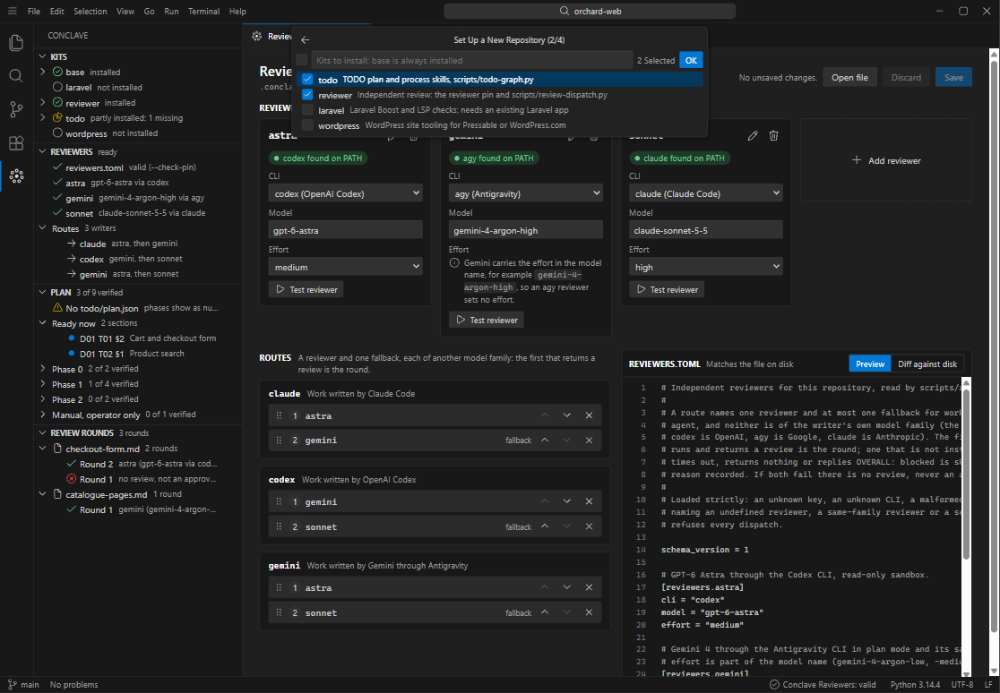
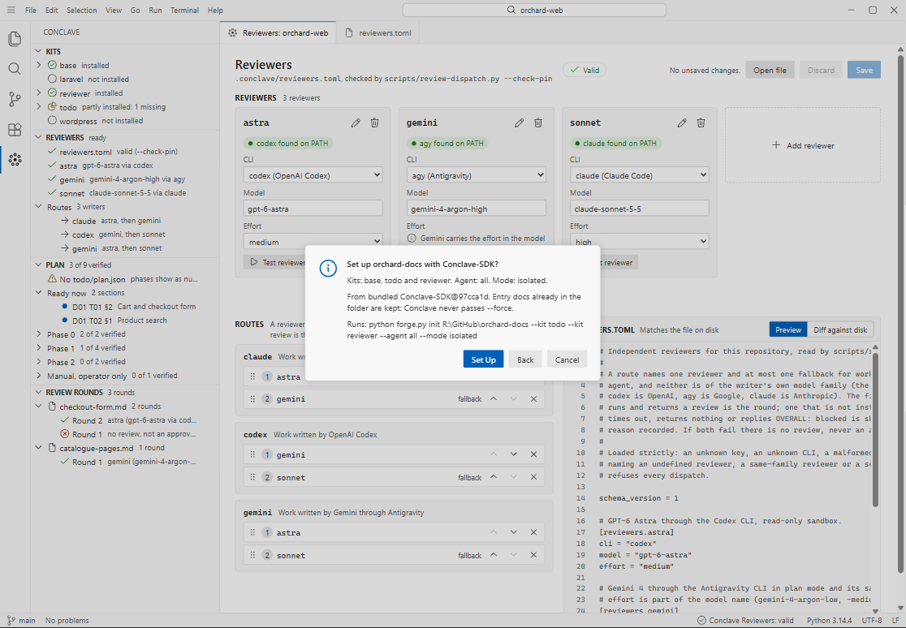

`Set up a new repository` (plan R31) is a native quick pick titled `Set Up a New Repository ({n}/{total})`, five steps when wordpress is chosen and four otherwise, with a Back arrow from step 2. Defaults: kits todo and reviewer, agent `all`, mode `isolated`, host `pressable`.

1. Folder: input with the placeholder `Folder for the new repository`, a `Browse...` button (codicon `folder`), and the message `forge.py init creates the folder if it does not exist and never overwrites an AGENTS.md, GEMINI.md, CLAUDE.md or CODEX.md already in it. Press 'Enter' to confirm your input or 'Escape' to cancel.`
2. Kits: multi-select with the placeholder `Kits to install; base is always installed`, `{n} Selected` and `OK`; one item per kit `forge.py kits` returns except base, with its description: `todo` `TODO plan and process skills, scripts/todo-graph.py`, `reviewer` `Independent review: the reviewer pin and scripts/review-dispatch.py`, `laravel` `Laravel Boost and LSP checks; needs an existing Laravel app`, `wordpress` `WordPress site tooling for Pressable or WordPress.com`. A kit the mockup predates (for example `automations`) shows the description its kit README gives.
3. Agent: placeholder `Agent folders to install`; `all` `Every agent: .agents, .claude and .codex`, `agy` `Antigravity`, `gemini` `Gemini, the same files as agy`, `claude` `Claude Code`, `codex` `OpenAI Codex`.
4. Mode: placeholder `Provisioning mode`; `isolated` `Default: the kits are copied in, the repository is self-contained`, `hybrid` `Copied in, plus .agents/skills.json pointing at the kits`, `inherit` `Copied in except the Antigravity skills: .agents/skills.json and plugins.json point at the kits`. For claude or codex, hybrid and inherit say they are the same as isolated for that agent.
5. Host (wordpress only): placeholder `WordPress host`; `pressable` `Pressable`, `wpcom` `WordPress.com`.

Confirmation, a modal: `Set up {name} with Conclave-SDK?`, `Kits: base, {kits}. Agent: {agent}. Mode: {mode}.` (plus ` WordPress host: {host}.`), `From {source}. Entry docs already in the folder are kept: Conclave never passes --force.`, `Runs: {argv}`, with `Set Up`, `Back` and `Cancel`. The result is a notification, `Set up {folder} with base, {kits}. The files forge wrote are listed in the Conclave output channel.`, with `Open`, `Open in New Window` and `Add to Workspace`. A forge error is a notification with its message and `Show log`.

## 12. Feature sections

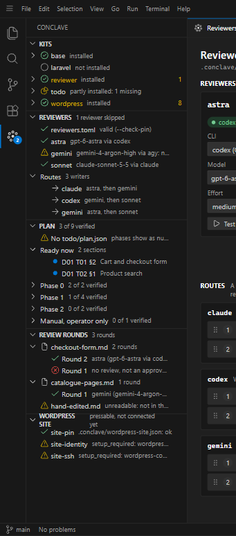
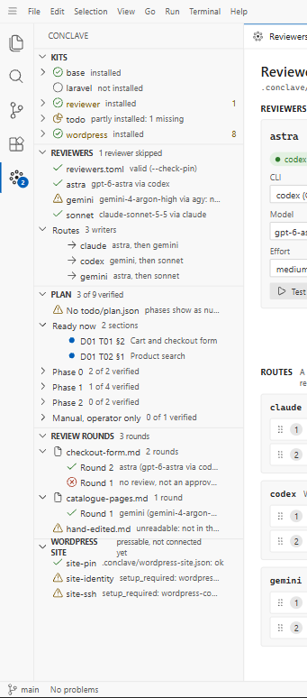

Under the Kits tree, one view per feature, each shown only while its kit is in the current folder, in the order REVIEWERS, PLAN, REVIEW ROUNDS and WORDPRESS SITE (plan R33 to R37, `design/decisions.md` answer 14). Row icons: `check` ok, `warning` warning, `error` error, `info` info, `circle-filled` ready, `lock` blocked, `file` a record, `arrow-right` a route.

REVIEWERS (reviewer kit): title actions `Open Reviewer Settings` and `Refresh`; description `ready` or `{n} reviewer skipped`. The first row is the pin's state: `reviewers.toml` `valid (--check-pin)` (or `valid, changed on disk`), `refused: {message}`, `valid; a layout the editor does not edit`, or `newer schema than this extension reads`; or `No reviewer pin` `.conclave/reviewers.toml is missing`, `No dispatcher` `scripts/review-dispatch.py is missing`, `Dispatcher too old` `no --check-pin; update from Conclave-SDK`, `No Python 3.11 or later` `nothing runs until one is found`, `Restricted Mode` `trust the workspace to run the dispatcher`, with an install action where one applies. With a valid pin, one row per reviewer (`{model} via {cli}`, or `{model} via {cli}: not on PATH, skipped`, action `Open {name} in Reviewer Settings`) and a `Routes` group (`{n} writers`) with one row per writer: `{reviewer}, then {fallback}` (the fallback of a third family).

PLAN (todo kit), read from `scripts/todo-graph.py query plan` (`D06 T01 §2`): title actions `Validate the plan`, `Open the plan` and `Refresh`; description `{n} of {m} verified`. Without `todo/plan.json` a first row `No todo/plan.json` `phases show as numbers`. Then `Ready now` (`{n} sections`), and one collapsed group per phase, `Phase {n}: {name}` or `Phase {n}`, described `{n} of {m} verified`. A section row is its reference, described by its title (plus ` (needs {ref})` when blocked), tooltip `{status}: {title}`, action `Open {ref}`.

REVIEW ROUNDS (reviewer kit), read from `scripts/review-dispatch.py --list-rounds --json` (`D06 T01 §3`): description `{n} rounds`; actions `Open docs/reviews` and `Refresh`; empty, `No rounds recorded yet` `docs/reviews/ is empty`. One group per findings file (`{n} rounds`) and one row per round, `Round {n}`: `{reviewer} ({model} via {cli}), writer {writer}, {run}` with an ok icon, or `no review, not an approval: {n} skipped` with an error icon. Action `Open round {n}`. A file the listing names as unreadable is shown, never dropped: a row with the `warning` icon, the file name as label, the description `unreadable: not in the record format`, the tooltip `{path}: a round heading or line is not in the format --record writes, or the file cannot be read`, and the action `Open {file}`.

WORDPRESS SITE (wordpress kit), from `forge.py doctor` for the kit: description `{host}` or `{host}, not connected yet`; actions `Open the site pin` and `Refresh`; one row per `site-` check, its detail when ok and `{status}: {detail}` otherwise. A setup_required row has `How to finish this step`, which says `The wordpress-connect skill fills this in: ask your agent to run it. The extension only reads the site pin.`
